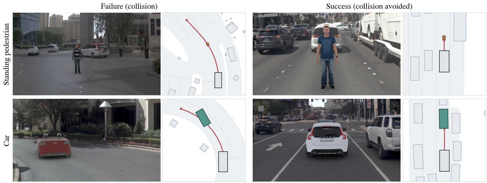
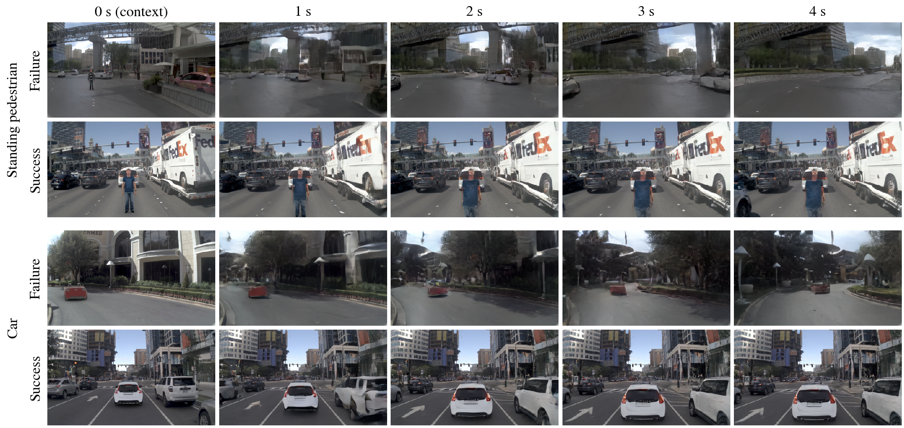
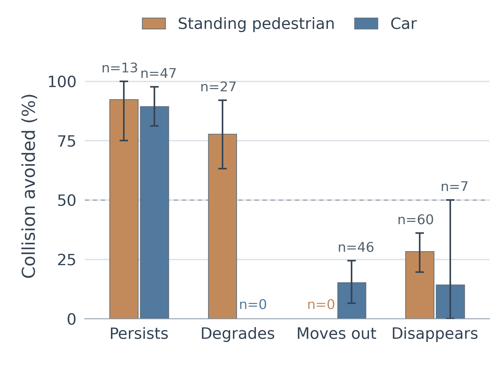

**TL;DR**:

One of the experiments I ran for the ReactBench-AD paper[^reactbench-ad] was to insert 3D assets of standing pedestrians and stationary cars in front of the ego vehicle in close proximity and test whether DriveWAM[^drivewam] can avoid collision in these hazardous cases. The main result was that DriveWAM (across other five models) barely reacts and in most cases collides with the inserted object. World-Action Models (WAMs) however, provide a very nice was to visually inspect what the model "imagines" that will happen, as it jointly[^jointly_explanation] predicts future frames and actions. To this end, we ran a few experiments to visualize and analyze the predicted frames of the model, which however didn't make it to the final cut of the paper as a deadline was pressing and the results where feeling to me as half-done job. However, instead of leaving these results buried in my university's cluster, I thought I could do a bit of effort to polish them and expand them slightly; hence this post.

<!-- Driving World-Action Models (WAMs) jointly[^jointly_explanation] predict future frames and actions. This offers an easy way to visually inspect what does the model predict that will happen. When evaluating two WAMs on how they react to imminent hazards (pedestrians and vehicles at a close distance) in their path we found that two recent WAMs DriveWAM, and SimWAM largely fail to properly react to these hazards, not managing to avoid collisions. Hence, the natural following question is: what do they imagine that will happen? Do they actually imagine that a collision will follow but they just go ahead anyways? -->

Given that SimWAM only predicts future frames at training, and action generation is not conditioned in any way on the future frames, we aim to answer this question based on DriveWAM only. First, we randomly select 200 samples from ReactBench-AD 100 with a standing pedestrian in the ego's path and 100 with a stationary vehicle. These are chosen based on the performance of DriveWAM on them. In half of them the model managed to avoid the collision, while in half of them not. We visualize one sample per object and per collision avoidance success:

*Figure 1. One sample per object type where DriveWAM collides (left) and avoids the collision (right).*

Next, we want to see if the imagined future differs between samples where DriveWAM slows down and avoids collision and samples for which it doesn't. And most importantly, does the model predict a collision but continues anyways? Or something else happens? 

DriveWAM predicts the trajectory conditioned on partially denoised future frame latents. So in order to be able to get clean images by passing the vidoe latents to the VAE decoder we will first need to further denoise the video latents[^design_choice]. To do this we keep denoising the video from raw r=0.4 to r=0 with 20 Euler steps (step size = 0.02). Below, we visualize the predicted future frames of DriveWAM for the four samples depicted in Figure 1:

*Figure 2. Predicted frames for the next 4 seconds for the examples of Figure 1.*

Given only these four samples we can already spot some differences between the success and failure samples. Regarding the standing pedestrian, we can see that in the success case the pedestrian persists in all predicted states while in the failure case the pedestrian completely disappears from the scene, already from the first predicted frame, and hence the vehicle now having a "clear road" ahead keeps driving. In the case of the inserted car, it persists in both success and failure but in the success case the model "imagines" that it actually stays stationary and succesfully stop before it, while in the failure case the model "imagines" that the vehicle ahead keeps moving and hence it things there will be space to keep driving.

In order to see whether these patterns hold for all 200 randomly selected samples we next manually label the samples to one of the following categories: (a) Persists, (b) Degrades, (c) Moves out, or (d) Disappears for when the object (a) persists, (b) degrades into an artifact that is difficult to recognise as the original object but remains in the ego vehicle's path, (c) persists but moves out of the ego's path, and (d) disappears completely. We label each sample without having access to the predicted trajectory, only to the predicted frames.

Having the labels in place we next measure the collision avoidance percentage for each category:

{: width="60%"}
*Figure 3. Collision avoidance percentage by sample label.*

As we can see, there is a strong correlation between the label assigned to the sample and whether the model avoids the collision or not. This indicates that the underlying reason of DriveWAM failing to avoid collision in these imminent hazard scenarios is the weak underlying world model which "breaks" and has a hard time staying consistent with the physical reality with objects disappearing or degrading into artifacts. At the same time, there is a very good reason for the model predicting that the vehicle ahead moves out of the way, and this is the fact that DriveWAM doesn't receive any temporal information through its visual channel (i.e. it sees a single frame). Having this in mind in most scenes there is no good reason for the model to assume that the vehicle ahead would be stalled. Exception to this are scenes like the bottom right one in Figure 1 where the whole scene, that is, a queue of vehicles waiting at a red light, indicates that the vehicle(s) ahead is stopped.

## Is this an artifact of the inserted assets?
The first question that comes to mind looking at these results is "Well, is this an artifact of the inserted 3D asset?". In other words, does the model fail to predict future frames consistent with the inserted object simply because the inserted object is not fully photorealistic? In order to answer this question, we curate some samples from NAVSIM that depict pedestrians and vehicles at close proximity from the ego vehicle. Then we edit the ego status of the sample, and increase its speed, so that it will look like to the model as if the ego is at a route of collision with the object ahead within 0.5/1/1.5/2 seconds, allowing us not only to see if the predicted frames turn out to not be consistent at certain cases but also compare the predicted frame as we change the ego status.

Next, using the same denoising method as before we further denoise the video latents and visualize the predicted frames for each of these samples:

<!-- Footnotes -->
[^reactbench-ad]: [ReactBench-AD: Do Driving VLAs and World-Action Models React to Imminent Hazards in Their Path?](https://arxiv.org/abs/2611.20011v2) (Theodoridis et al, 2026)
[^drivewam]: [DriveWAM: Video Generative Priors Enable Scalable World-Action Modeling for Autonomous Driving](https://arxiv.org/abs/2605.28544) (Shi et al, 2026)
[^jointly_explanation]: "Jointly" is a bit of a oversimplification here. The approaches actually vary. Some models, like [DriveWAM](https://arxiv.org/abs/2605.28544) (partially) denoise the future frames then and then conditioned on that they denoise the action tokens, while other models, like [4D-WAM](https://arxiv.org/abs/2608.10107) denoise both jointly.
[^design_choice]: How to further denoise the video latents is a design choice that could potentially influence the results of this experiment. Here we simply keep denoising the video latents with more dense euler steps (20 steps in total) for a better visual result and we don't run any ablations on the impact of this choice on the downstream results.