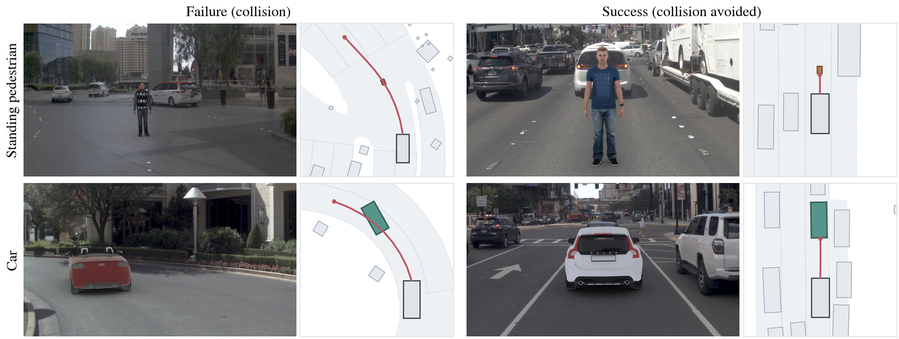
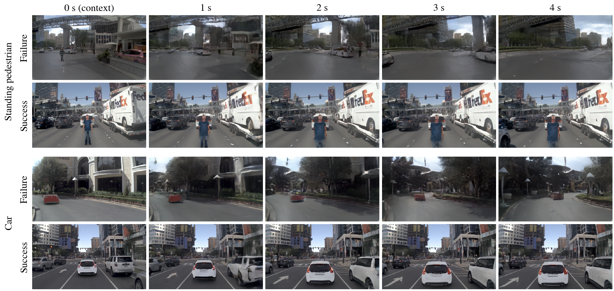
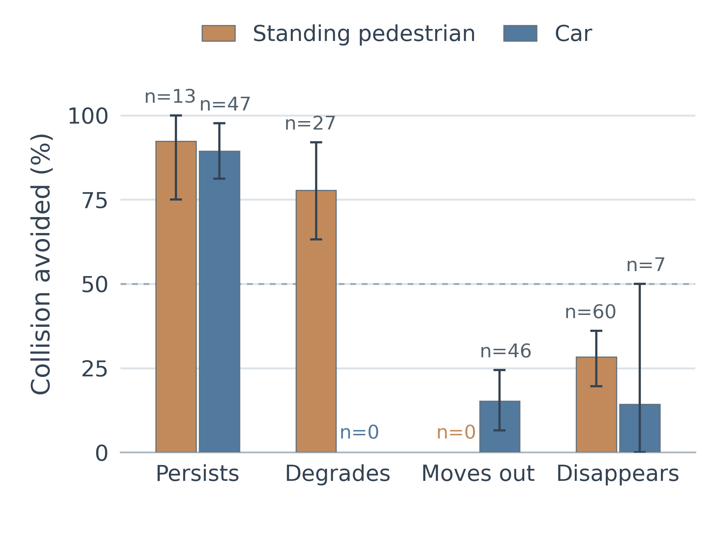
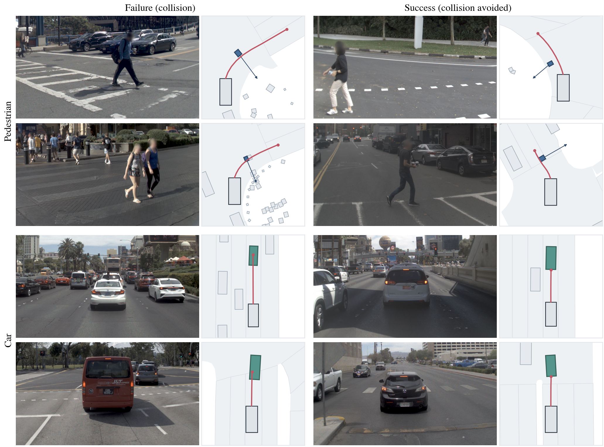
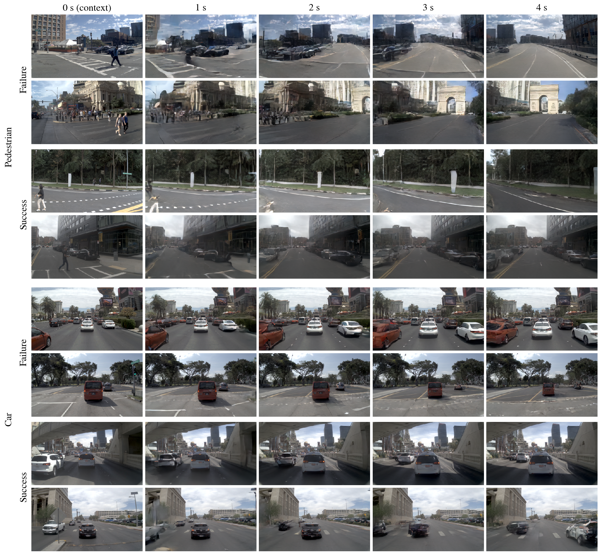
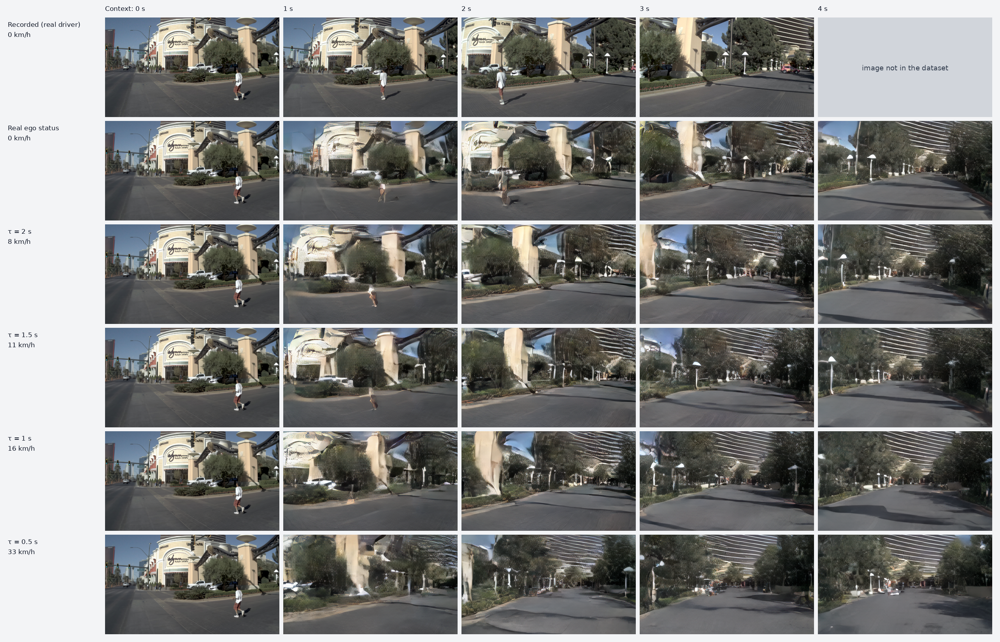
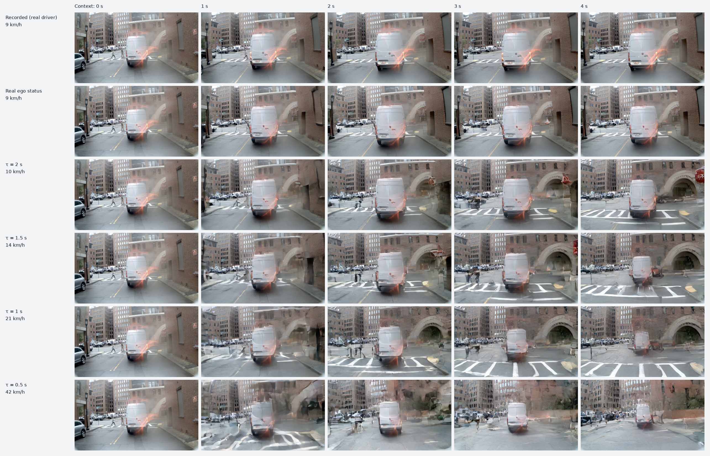

**TL;DR**: When inserting pedestrians or vehicles in close proximity to existing scenes, DriveWAM collides most of the time, and when visualizing what it "imagines" it becomes clear that the model doesn't actually predicts a collision but it either completely omits the inserted object from future frames or imagines it moving out of the ego vehicle's way in the case of the car. This happens with fully real scenes too, where increasingly aggresive edits of the ego status reveal a world model that can't model reality very well in these situations and instead makes for example pedestrians disappear from predicetd future frames to stay consistent with ego status.
{: .tldr}

One of the experiments I ran for the ReactBench-AD paper[^reactbench-ad] was to insert 3D assets of standing pedestrians and stationary cars in front of the ego vehicle in close proximity and test whether a driving World-Action Model (WAM), DriveWAM[^drivewam], can avoid collision in these hazardous cases. The main result was that DriveWAM (and five other tested VLAs and WAMs) barely reacts and in most cases collides with the inserted object. WAMs however, provide a very nice way to visually inspect what the model "imagines" that will happen, as it jointly[^jointly_explanation] predicts future frames and actions. To this end, we ran a few experiments to visualize and analyze the predicted frames of the model, which however didn't make it to the final cut of the paper as a deadline was pressing and the results where feeling to me as half-done job. However, instead of leaving these results buried in my university's cluster, I thought I might as well put them in a short blog post, as they are interesting to look at in my opinion; hence this post.

## Inserted 3D assets
First, we want to examine what does DriveWAM imagine that will happen when inserting a pedestrian or vehicle in its path and how what it imagines differs when colliding in comparison to when avoiding collision. We select 200 samples from ReactBench-AD 100 with a standing pedestrian in the ego's path and 100 with a stationary vehicle. In half of them the model managed to avoid the collision, while in half of them not. We visualize one sample per object and per collision avoidance success:


*Figure 1. One sample per object type where DriveWAM collides (left) and avoids the collision (right).*

DriveWAM predicts the trajectory conditioned on partially denoised future frame latents. So in order to be able to get clean images by passing the video latents to the VAE decoder we will first need to further denoise the video latents[^design_choice]. To do this we keep denoising the video from raw r=0.4 to r=0 with 20 Euler steps (step size = 0.02). Below, we visualize the predicted future frames of DriveWAM for the four samples depicted in Figure 1:


*Figure 2. Predicted frames for the next 4 seconds for the examples of Figure 1.*

Given only these four samples we can already spot some differences between the success and failure samples. Regarding the standing pedestrian, we can see that in the success case (second row) the pedestrian persists in all predicted frames while in the failure case the pedestrian completely disappears from the scene, already from the first predicted frame, and hence the vehicle now having a "clear road" ahead keeps driving. In the case of the inserted car, it persists in both success and failure but in the success case the model "imagines" that it actually stays stationary and succesfully stops before it, while in the failure case the model "imagines" that the vehicle ahead keeps moving and hence it things there will be space to keep driving. This second, related to the inserted car, failure, is actually perfectly understandable, given that DriveWAM takes a single frame as input and hence it has not good reason to believe that the car ahead is stopped, unless if other contextual information (queue on a junction, red light etc.) suggests so. This, however, is a good example of why temporal visual information is really need for informed decisions.

In order to see whether these patterns hold for all 200 randomly selected samples we next manually label the samples to one of the following categories: (a) Persists, (b) Degrades, (c) Moves out, or (d) Disappears for when the object (a) persists, (b) degrades into an artifact that is difficult to recognise as the original object but remains in the ego vehicle's path, (c) persists but moves out of the ego's path, and (d) disappears completely. We label each sample without having access to the predicted trajectory, only to the predicted frames.

Having the labels in place we next measure the collision avoidance percentage for each category:

{: width="60%"}
*Figure 3. Collision avoidance percentage by sample label.*

As we can see, there is a strong correlation between the label assigned to the sample and whether the model avoids the collision or not. This indicates that the underlying reason of DriveWAM failing to avoid collision in these imminent hazard scenarios is the weak underlying world model which "breaks" and has a hard time staying consistent with the physical reality with objects disappearing or degrading into artifacts. 

## Is this an artifact of the inserted assets?
The first question that comes to mind looking at these results is "Well, is this an artifact of the inserted 3D asset?". In other words, does the model fail to predict future frames consistent with the inserted object simply because the inserted object is not fully photorealistic? In order to answer this question, we curate some samples from NAVSIM[^navsim] that depict pedestrians and vehicles at close proximity from the ego vehicle. Then we edit the ego status of the sample, and increase its speed, so that it will look like to the model as if the ego is at a route to collision with the object ahead within 0.5/1/1.5/2 seconds, allowing us not only to see if the predicted frames turn out to not be consistent at certain cases but also examine how the predicted future changes as we edit the ego status more aggressively. Below are eight samples similar to Figure 1:


*Figure 4. Examples of real NAVSIM scenes with vehicles and pedestrians at close proximity, along with the predicted DriveWAM trajectories in BEV. Blur was added later.*

Using the same denoising method as before we further denoise the video latents and visualize the predicted frames for each of these samples after editing their ego status to increase the speed of the ego vehicle so that, if kept constant, a collision would occur after 2 seconds:


*Figure 5. Predicted future frames for the samples of Figure 4 with edited ego status.*

One interesting observation is that the model seems to have a hard time modeling pedestrians, as the pedestrians disappear from the scenes even in the cases where the model avoids collision, where, however, the only reason of the avoided collision is that the walking pedestrian cleared the vehicle's path rather than that the vehicle slowed down. Regarding the vehicles, similar to the inserted 3D assets, we see that when DriveWAM fails to slow down is because it "imagines" the vehicle ahead driving forward. While in one of the success cases (top) the vehicle stays still, in the other one (bottom) the model still "imagines" the vehicle ahead driving through, which is still a failure of the world model as the opposite coming traffic simply disappears to thin air, however, the predicted trajectory still doesn't collide showing that there isn't a perfect correlation "vehicle ahead moves out of the way" -> "collision".

Finally, it is interesting to visually inspect how the predicted future frames change while increasing the speed in the ego status. In the two figures below we visualize the predicted frames for the original ego status and four edited ego statuses in order of increasing speed:


*Figure 6. Top: Real recorded frames, Second row: Predicted future frames with the original ego status, Rows 3-6: Predicted future frames with edited ego status in order of increasing speed that would lead the vehicle into collision after τ=0.5/1/1.5/2 seconds.*


*Figure 7. Top: Real recorded frames, Second row: Predicted future frames with the original ego status, Rows 3-6: Predicted future frames with edited ego status in order of increasing speed that would lead the vehicle into collision after τ=0.5/1/1.5/2 seconds.*

Starting with Figure 6, the first interesting thing is that the model fails to properly model the pedestrian and they are turned into a blurred artifcat already on the first predicted frame, even with the unmodified ego status[^modeling_pedestrian_caveat]. Then when artificially increasing the ego speed, the pedestrian disappears from the scene already from the second predicted frame (where originally there was still an artifact) and when further increasing the speed (last two rows) the pedestrian completely disappears from the scene already from the first predicted frame. This clearly highlights a failing world model underneath, which can't understand that simply because the ego speed is higher it doesn't mean that objects can simply disappear out of our way.

Regarding Figure 7, with the original ego status the van ahead is predicted to still stand before the zebra crossing 4 seconds later, while when increasing the ego speed is predicted to move further and further ahead despite the fact that there are pedestrians on the zebra crossing, highlighting again a relatively weak world model that changes the reality around it to fit the vehicle's speed, instead of changing the vehicle's speed to fit the reality.

## Discussion
I think these results highlight the underlying reason that current WAMs fail in hazardous scenarios like those we examined: the world model foundation of the world action model seems to be relatively weak, failing to predict a consistent future, making things conviniantly disappear so that the ego vehicle can keep driving as the ego status indicates.

## Citation

```bibtex
@misc{theodoridis2026drivewamimagines,
  author = {Theodoridis, Nikos},
  title = {Do driving {WAMs} imagine a collision when they collide?},
  howpublished = {Nikos Theodoridis' blog},
  year = {2026},
  month = nov,
  url = {https://niktheod.github.io/blog/drivewam-imagines.html}
}
```


<!-- Footnotes -->
[^reactbench-ad]: [ReactBench-AD: Do Driving VLAs and World-Action Models React to Imminent Hazards in Their Path?](https://arxiv.org/abs/2611.20011v2) (Theodoridis et al, 2026)
[^drivewam]: [DriveWAM: Video Generative Priors Enable Scalable World-Action Modeling for Autonomous Driving](https://arxiv.org/abs/2605.28544) (Shi et al, 2026)
[^jointly_explanation]: "Jointly" is a bit of a oversimplification here. The approaches actually vary. Some models, like [DriveWAM](https://arxiv.org/abs/2605.28544) (partially) denoise the future frames and then conditioned on that they denoise the action tokens, while other models, like [4D-WAM](https://arxiv.org/abs/2608.10107) denoise both jointly.
[^design_choice]: How to further denoise the video latents is a design choice that could potentially influence the results of this experiment. Here we simply keep denoising the video latents with more dense euler steps (20 steps in total) for a better visual result and we don't run any ablations on the impact of this choice on the downstream results.
[^navsim]: [NAVSIM: Data-Driven Non-Reactive Autonomous Vehicle Simulation and Benchmarking](https://arxiv.org/abs/2406.15349) (Dauner et al, 2024)
[^modeling_pedestrian_caveat]: However, as mentioned earlier this could also be an artifact of our denoising method.